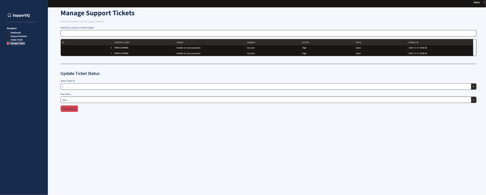

# SupportIQ 🎧
### Intelligent Customer Support Management System

SupportIQ is a web-based customer support management system developed using Python and Streamlit. It provides a centralized platform to create, organize, track, and manage customer support tickets.

The application includes an NLP-based FAQ assistant, automatic ticket category suggestions, ticket status management, resolution notes, and interactive analytics.

---

## 🚀 Key Features

- **Interactive Dashboard:** Monitor total tickets, open tickets, in-progress tickets, and resolved tickets.
- **NLP-Based Support Assistant:** Find relevant answers from predefined FAQs using TF-IDF and cosine similarity.
- **Ticket Creation:** Create support requests with customer details, subject, description, and priority.
- **Automatic Category Suggestion:** Suggest relevant ticket categories based on description similarity.
- **Ticket Management:** Search tickets and update their status.
- **Resolution Notes:** Add and save notes when handling customer issues.
- **Support Analytics:** Visualize ticket status and category distribution through interactive charts.
- **Local Database:** Store customer and ticket information using SQLite.

---

## 🛠️ Technology Stack

| Technology | Application |
|---|---|
| Python | Backend development |
| Streamlit | Web application interface |
| SQLite | Database management |
| Pandas | Data processing |
| Plotly | Interactive charts and visualizations |
| Scikit-learn | NLP text processing and similarity matching |

---

## 📸 Application Screenshots

### 1. Create Support Ticket


### 2. Ticket Creation Interface


### 3. Support Assistant


### 4. Manage Support Tickets



### 5. Updated Ticket Status


---

## 🧠 How the Support Assistant Works

SupportIQ uses Natural Language Processing techniques to identify relevant FAQ answers.

1. Predefined questions and answers are maintained in the application.
2. TF-IDF converts FAQ questions into numerical feature vectors.
3. Cosine similarity compares the user's query with existing FAQ questions.
4. The most relevant matching answer is returned.

**Note:** The assistant uses similarity-based FAQ matching. It does not currently use a generative AI or large language model.

---

## 🗄️ Database Design

SupportIQ uses SQLite for local data storage.

The database maintains:

- Customer information
- Support ticket details
- Ticket priority and category
- Ticket status
- Resolution notes

The database is initialized automatically when the application starts.

---

## ⚙️ Installation and Setup

Follow these steps to run SupportIQ locally.

### 1. Clone the repository

```bash
git clone https://github.com/prajapatisrushti/SupportIQ.git
```

### 2. Navigate to the project directory

```bash
cd SupportIQ
```

### 3. Create a virtual environment

```bash
python -m venv .venv
```

### 4. Activate the virtual environment

For Windows PowerShell:

```powershell
.\.venv\Scripts\Activate.ps1
```

### 5. Install the required dependencies

```bash
pip install -r requirements.txt
```

### 6. Run the application

```bash
streamlit run app.py
```

The application will open in your default web browser.

---

## 📁 Project Structure

```text
SupportIQ/
│
├── app.py
├── database.py
├── support_engine.py
├── requirements.txt
├── .gitignore
├── README.md
│
├── CREATE TICKET.png
├── CREATETICKET.png
├── MANAGETICKET.png
├── SUPPORT ASSIST.png
└── UPDATED STATUS.png
```

---

## 🔮 Future Enhancements

- User authentication and role-based access.
- Email notifications for ticket updates.
- Advanced customer support analytics.
- Generative AI integration for intelligent responses.
- Cloud database integration.
- Deployment for online access.

---

## 👩‍💻 Author

**Srushti Prajapati**

B.Sc. Computer Science Student  
Interested in Artificial Intelligence, Software Development, and Product Development.

- GitHub: [@prajapatisrushti](https://github.com/prajapatisrushti)
- Project Repository: [SupportIQ](https://github.com/prajapatisrushti/SupportIQ)

---

⭐ If you find this project interesting, consider giving the repository a star!
